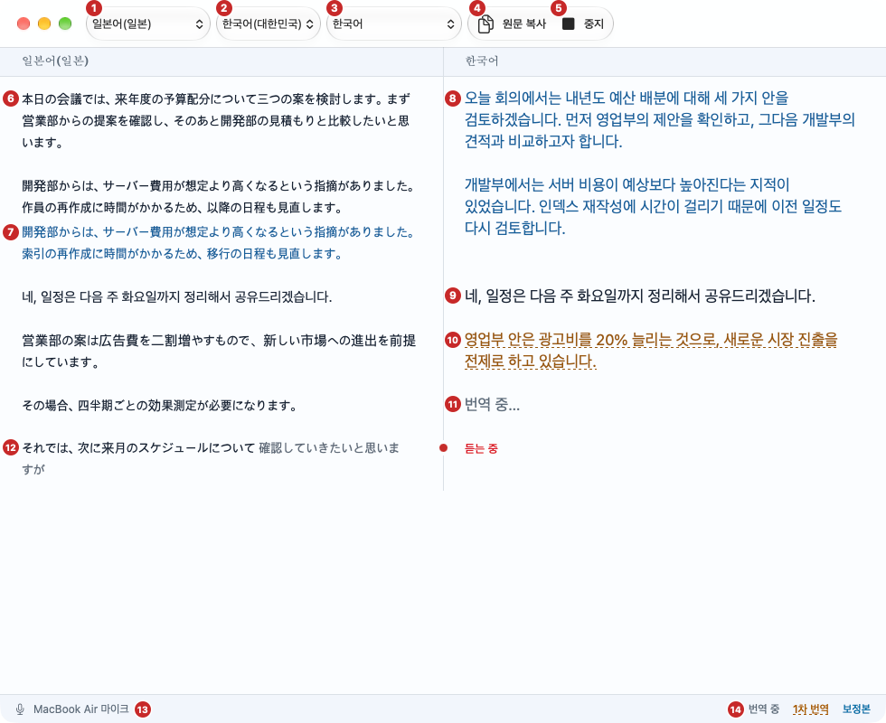
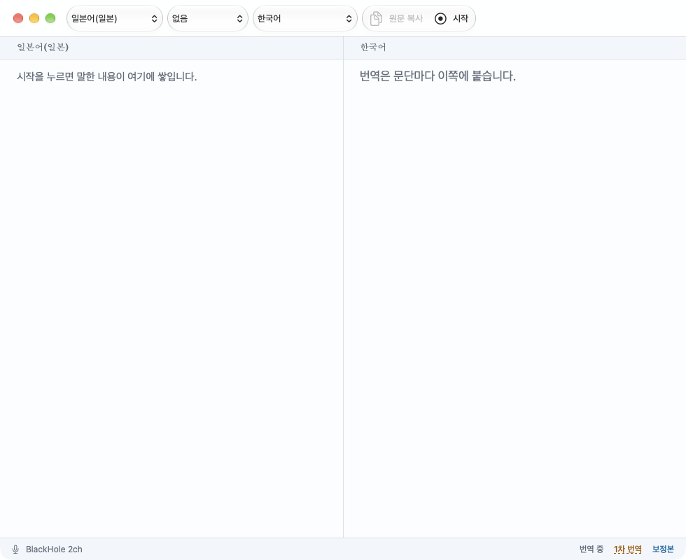
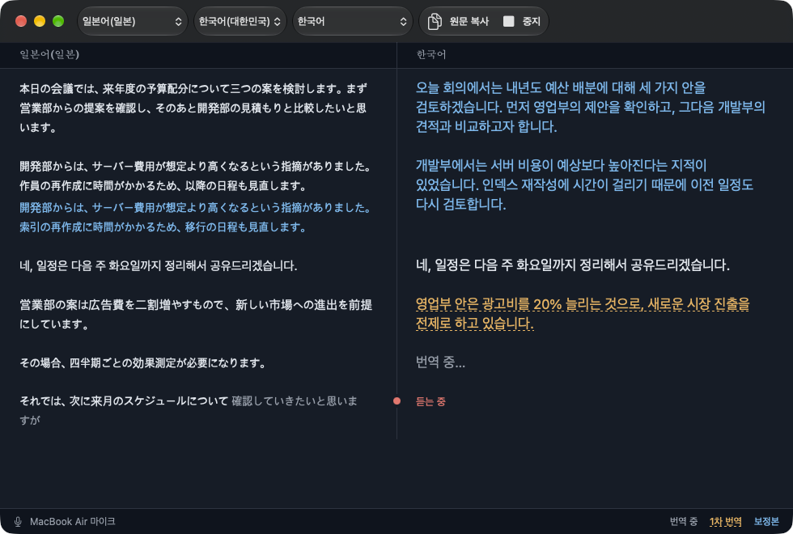

# live-trans

맥 마이크로 들은 말을 실시간으로 받아 적고, 문단마다 다른 언어로 번역해 원문 옆에 나란히 보여 주는 macOS 앱입니다.
전사와 번역은 맥 안에서(온디바이스) 처리합니다. 번역을 다듬는 후보정만 설정에서 OpenAI·Claude·로컬 LLM 서버로 바꿀 수 있습니다. 회의나 강연을 들으며 일본어를 한국어로 따라 읽는 용도로 만들었습니다.



*왼쪽에 원문이, 오른쪽에 번역이 문단마다 같은 높이로 쌓입니다. 그림 속 번호는 아래 [화면 읽는 법](#화면-읽는-법)에서 설명합니다. (예시 화면)*

## 필요한 환경

- macOS 27 이상, Apple 실리콘 맥
- 마이크 사용 권한
- 보정본(아래 [번역 단계](#번역-단계) 참고)을 온디바이스로 받으려면 시스템 설정에서 Apple Intelligence가 켜져 있어야 합니다. 꺼져 있으면 1차 번역까지만 나옵니다. 외부 모델을 고르면([후보정 설정](#후보정-설정)) 필요하지 않습니다.

## 설치

1. [Releases](https://github.com/manuel71sj/live-trans/releases)에서 최신 `LiveTrans-v0.1.<빌드>.zip`을 받습니다.
2. 압축을 풀고 `LiveTrans.app`을 응용 프로그램 폴더로 옮깁니다.
3. 처음 한 번은 앱을 **우클릭 → 열기**로 실행합니다. 개발자 서명이 없는 앱이라 그냥 더블클릭하면 macOS가 실행을 막습니다.

## 사용법

앱을 처음 열면 아래처럼 빈 화면이 나옵니다. 원문과 번역이 어느 쪽에 쌓이는지 미리 적혀 있습니다.



1. 툴바 왼쪽에서 **원문 언어**(말하는 언어)와 **번역 언어**를 고릅니다. 처음에는 일본어 → 한국어로 잡혀 있습니다.
2. 하단 상태 줄에 "번역 언어팩 설치가 필요합니다"가 보이면 **설치**를 눌러 언어팩을 받습니다. 설치가 끝나야 **시작** 버튼이 켜집니다.
   "지원하지 않는 언어쌍입니다"가 보이면 다른 조합을 골라 주세요.
3. 툴바 오른쪽의 **시작**을 누릅니다. 처음 시작할 때는 마이크 권한을 묻고, 고른 언어의 음성 모델을 내려받습니다("음성 모델 준비 중…").
4. 말하면 왼쪽 열 맨 아래에 받아 적힙니다. 가운데 선 위에 빨간 점과 "듣는 중"이 보이면 듣고 있는 상태입니다.
5. 문단이 끝나면 오른쪽 열에 번역이 붙습니다. 처음에는 호박색 1차 번역이 나오고, 잠시 뒤 파란색 보정본으로 바뀝니다.
6. 다 들었으면 **중지**를 누릅니다. 아직 문단으로 묶이지 않은 말도 마지막 문단으로 번역됩니다.

### 화면 읽는 법

맨 위 그림의 번호와 같습니다.

| 번호 | 이름 | 설명 |
|---|---|---|
| 1 | 원문 언어 | 말하는 사람의 언어를 고릅니다 |
| 2 | 번역 언어 | 번역해서 볼 언어를 고릅니다 |
| 3 | 원문 복사 | 지금까지 확정된 원문 전체를 클립보드에 복사합니다 |
| 4 | 시작 / 중지 | 듣기를 시작하거나 멈춥니다. 듣는 동안에는 "중지"로 바뀝니다 |
| 5 | 원문 열 | 받아 적은 원문입니다. 문단마다 한 덩어리로 쌓입니다 |
| 6 | 보정본 (파란색) | 다듬어진 최종 번역입니다 |
| 7 | 1차 번역 (호박색 + 점선 밑줄) | 기계 번역 결과입니다. 곧 보정본으로 바뀝니다 |
| 8 | 번역 중 (회색) | 번역을 기다리는 문단입니다 |
| 9 | 진행 중 문단 | 지금 받아 적는 중인 말입니다. 옅은 글자는 아직 확정되지 않아 바뀔 수 있습니다. 오른쪽의 빨간 점과 "듣는 중"이 듣고 있다는 표시입니다 |
| 10 | 범례 | 번역 단계별 색을 보여 줍니다 |

다크 모드에서는 이렇게 보입니다. 시스템 설정을 따라 자동으로 바뀝니다.



### 번역 단계

| 표시 | 뜻 |
|---|---|
| 회색 "번역 중…" | 번역을 기다리는 중입니다 |
| 호박색 + 점선 밑줄 | 1차 번역(기계 번역 결과)입니다 |
| 파란색 | 보정본입니다. 후보정에 고른 언어 모델이 직전 문단의 흐름을 참고해 1차 번역을 다듬은 결과입니다 |

보정이 실패하거나 고른 모델을 쓸 수 없으면(온디바이스는 Apple Intelligence가 꺼진 경우, 외부 모델은 서버나 키 문제) 1차 번역이 그대로 남습니다. 1차 번역부터 실패하면 그 자리에 "번역 실패: 이유"가 호박색으로 나옵니다.
1차 번역은 문단 순서대로 나오고, 후보정도 문단 순서대로 진행됩니다. 후보정이 느려도 다음 문단의 1차 번역은 기다리지 않습니다. 색을 구분하기 어려워도 점선 밑줄이 있으면 1차 번역, 없으면 보정본입니다.

### 후보정 설정

설정 창(⌘,)의 **후보정** 구획에서 보정본을 만드는 모델을 고릅니다. 바꾼 설정은 그다음에 시작하는 문단의 후보정부터 적용됩니다.

| 항목 | 설명 |
|---|---|
| 제공자 | 온디바이스(기본) · OpenAI API · Claude API · 로컬 LLM (OpenAI 호환) |
| Base URL | 로컬 LLM만 해당합니다. `/v1`까지 적습니다(예: `http://서버주소:8000/v1`). 같은 네트워크의 IP 주소나 `.local` 이름이면 `http`도 됩니다 |
| 모델 | 제공자의 모델 id입니다. 로컬 LLM은 서버의 `/v1/models`가 돌려주는 id를 적습니다(모델 파일 경로가 아닙니다). 비워 두거나 틀리면 호출이 실패해 1차 번역이 남습니다 |
| Effort | 지정 안 함 · low · medium · high. 지정 안 함이면 값을 보내지 않습니다 |
| API 키 | 키체인에 저장합니다. 로컬 LLM은 비워도 됩니다 |

온디바이스를 고르면 다른 항목은 없고 지금까지와 똑같이 동작합니다.
**외부 모델을 고르면 문단 원문과 1차 번역, 그리고 직전 문단의 원문과 번역이 그 서버로 전송됩니다.** 회의 내용이 밖으로 나가도 되는 서버인지 확인한 뒤 고르세요.

### 문단이 나뉘는 기준

- 말이 **10초** 동안 끊기면 거기서 문단을 마치고 번역합니다.
- 다만 그때까지 쌓인 말이 **5초**보다 짧으면 맥락이 부족하므로 다음 말과 합칩니다.
- 끊김 없이 **60초**를 넘기면 문장이 끝나는 곳에서 문단을 마칩니다.
- **중지**하면 남은 말을 길이와 상관없이 마지막 문단으로 번역합니다.

### 그 밖의 기능

- **원문 복사**: 확정된 원문을 문단 사이에 빈 줄을 넣어 복사합니다. 진행 중 문단의 옅은 글자는 빠집니다.
- **스크롤**: 맨 아래를 보고 있으면 새 내용을 따라 내려갑니다. 위로 올려 두면 그 위치에 머뭅니다.
- **텍스트 선택**: 원문과 번역 모두 드래그해서 선택하고 복사할 수 있습니다.

## 문제 해결

| 증상 | 해결 방법 |
|---|---|
| "마이크 권한이 없습니다" | 시스템 설정 → 개인정보 보호 및 보안 → 마이크에서 LiveTrans를 켜 주세요 |
| 시작 버튼이 눌리지 않음 | 하단 상태 줄을 확인해 주세요. 언어팩 설치가 필요하거나 지원하지 않는 언어쌍입니다 |
| 번역이 계속 호박색으로만 나옴 | 온디바이스라면 Apple Intelligence가 켜져 있는지, 외부 모델이라면 설정의 Base URL·모델·API 키를 확인해 주세요 |
| 앱이 열리지 않음("확인되지 않은 개발자") | 앱을 우클릭 → 열기로 실행해 주세요 |

## 소스에서 빌드

Xcode 27과 [XcodeGen](https://github.com/yonaskolb/XcodeGen)이 필요합니다.

```sh
xcodegen generate
xcodebuild -project LiveTrans.xcodeproj -scheme LiveTrans -configuration Debug -derivedDataPath build build
open build/Build/Products/Debug/LiveTrans.app
```

처음 한 번은 Xcode로 프로젝트를 열어 AnyLanguageModel 매크로를 **Trust & Enable** 해야 명령줄 빌드가 됩니다.

로컬 빌드의 버전은 `0.1.0`(빌드 0)으로 표시됩니다. 커밋 수가 빌드 번호로 들어가는 것은 릴리스 빌드뿐입니다.

## 릴리스

main에 push하면 이 맥에서 앱을 빌드해 GitHub Releases에 올립니다. 버전은 `0.1.<커밋 수>`이고 커밋 수가 빌드 번호입니다(태그 `v0.1.<커밋 수>`).
앞자리 `0.1`은 `project.yml`의 `MARKETING_VERSION`에서 바꿉니다. 변경 이력은 직전 릴리스 이후의 커밋 제목으로 만듭니다.
push 직전에 빌드하므로 빌드가 실패하면 push도 중단됩니다. 클론마다 한 번 다음 명령으로 켜 주세요.

```sh
git config core.hooksPath scripts/hooks
```
